# CSE Advisor

A personal **analysis tool** for the Colombo Stock Exchange (CSE). You choose 10–20 stocks. After every close it scans each one for chart patterns, liquidity, levels and company announcements, and shows what its three rule-based engines (Original, Analyst, Smart-Money) found, **with the reason and the arithmetic behind every number**. Detected patterns are drawn on a live chart, and an optional Telegram bot sends a daily digest.

Everything runs on your own computer with free data. There is no login, no cloud service and no trading: it never places an order.

> ## ⚠️ Not financial advice
> **CSE Advisor is a software tool that organises public market data and applies fixed technical-analysis rules to it. It is not financial, investment, legal or tax advice, and it is not a recommendation to buy, sell or hold any security.** The author is not a licensed financial adviser, and giving personalised investment advice may require a licence in your country. Words such as *BUY*, *WATCH*, *AVOID*, *entry*, *stop* and *target* are labels the rules produce from price history; they are not instructions.
>
> - **No edge is claimed.** The project's own 14-year tests (below) found that most patterns do **not** predict price beyond the stock's existing trend, and that after CSE trading costs (about 2.6% for a round trip) the average trade loses money. The tool is for studying and organising, not for generating returns.
> - Markets can fall; you can lose all the money you put in. Past patterns do not predict future prices.
> - Data comes from unofficial, undocumented endpoints (cse.lk, TradingView) that can be wrong, late or disappear. Always check prices with your broker.
> - Make your own decisions, or ask a licensed adviser. Paper-trade before using real money. The software is provided "as is", without warranty of any kind, and the author accepts no liability for losses.
>
> This project is not affiliated with, or endorsed by, the Colombo Stock Exchange, TradingView, or any broker. Check each data provider's terms before using it.

## Screenshots

All screenshots show the app on 4 Nov 2026 with seven example stocks. They are illustrations of the tool's output, not suggestions.

**Watchlist:** every stock with the three engines' verdicts side by side, trend, liquidity grade and the next key level.

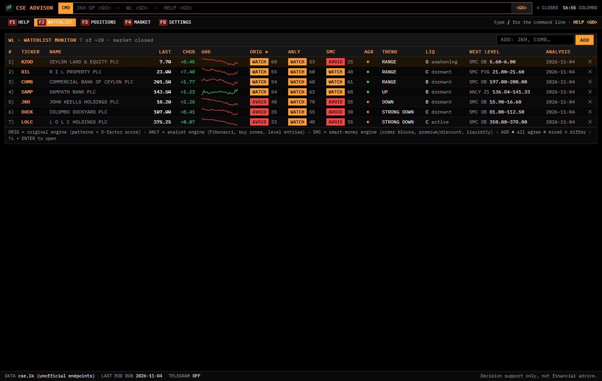

**Stock page:** three engine panels, the strip of everything drawn on the chart, and the chart with patterns, zones and plan lines. Timeframes 1M to 1W; candles, line and zig-zag.

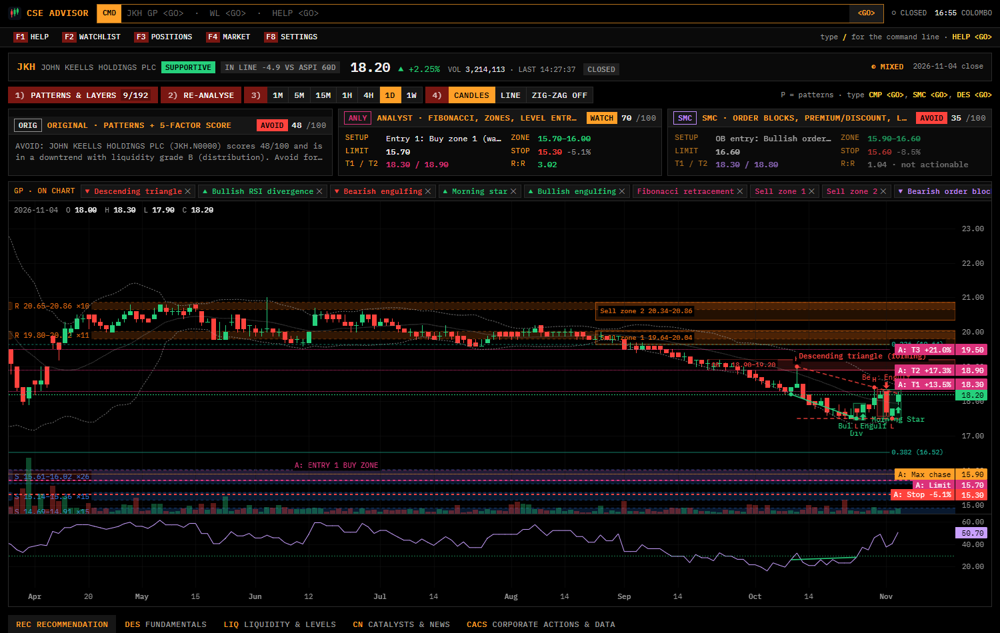

**Line chart with zig-zag swings**, to see the trend with less noise:

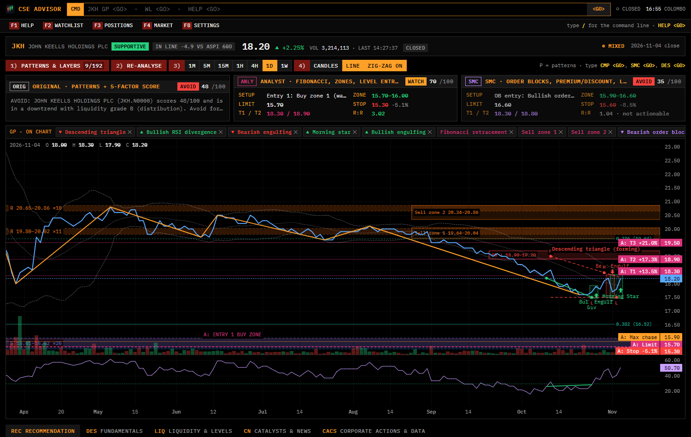

**Pattern chooser:** every pattern found, ranked, each with its own switch; presets for each engine; filters by category, direction, status and age.

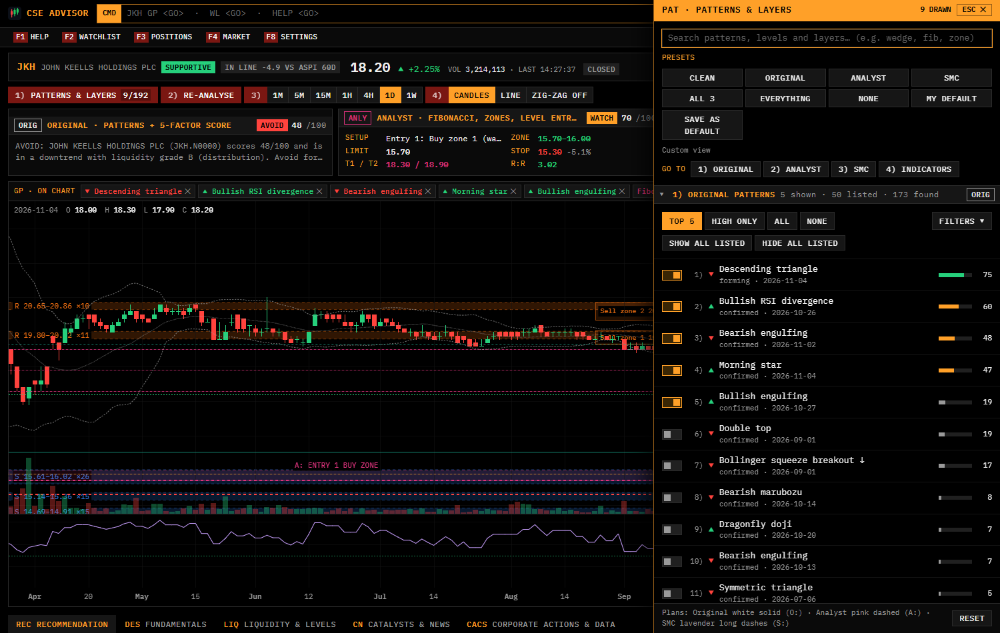

**Comparing the engines:** each engine's setup, prices, checklist and reasons for and against, written in plain language. When they disagree, the page says so.

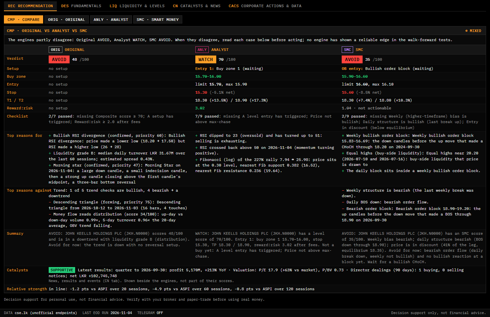

| Original engine | Smart-money engine |
|---|---|
| 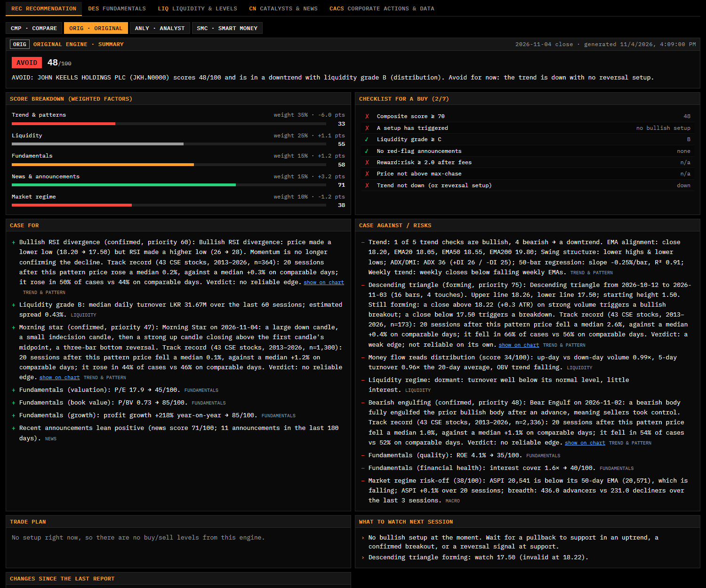 | 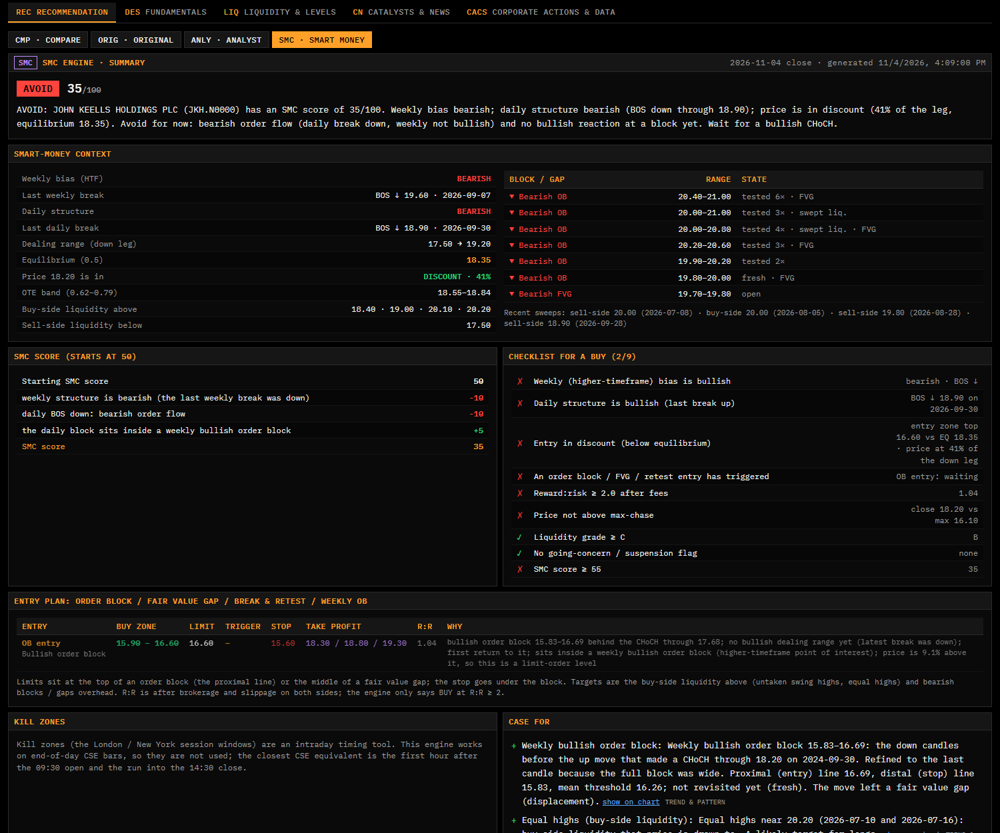 |

**Intraday charts** (the engines run on demand on the bars of the chart's timeframe):

| 15 minute | 1 minute |
|---|---|
| 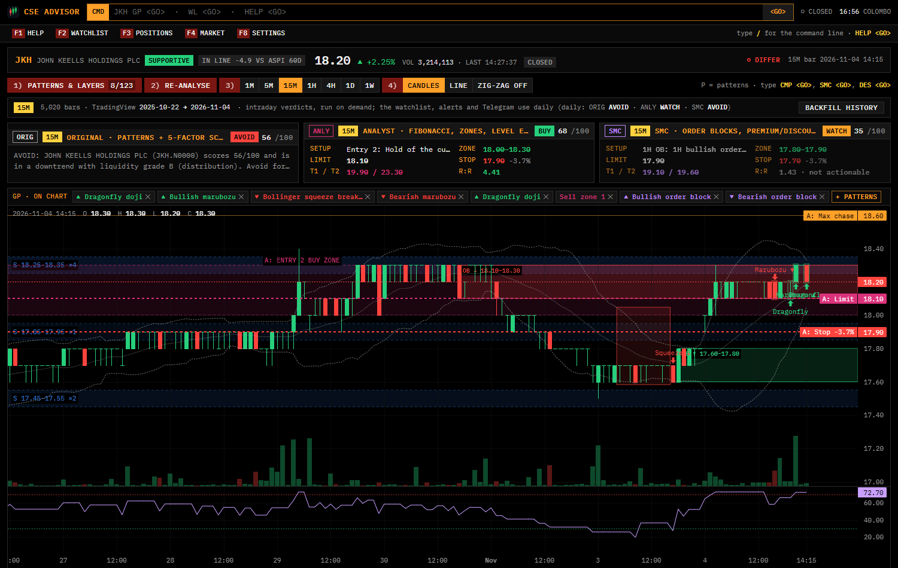 | 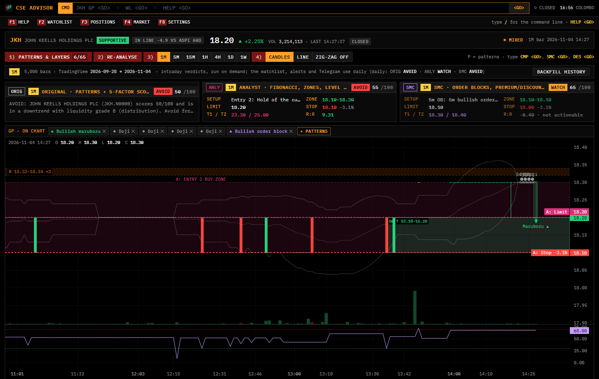 |

**Fundamentals and reports:** figures read from the CSE statements with cross-checks, ratios, and a table of the PDF links with the *expected date of the next quarterly and annual report* (an estimate from the company's own filing history).

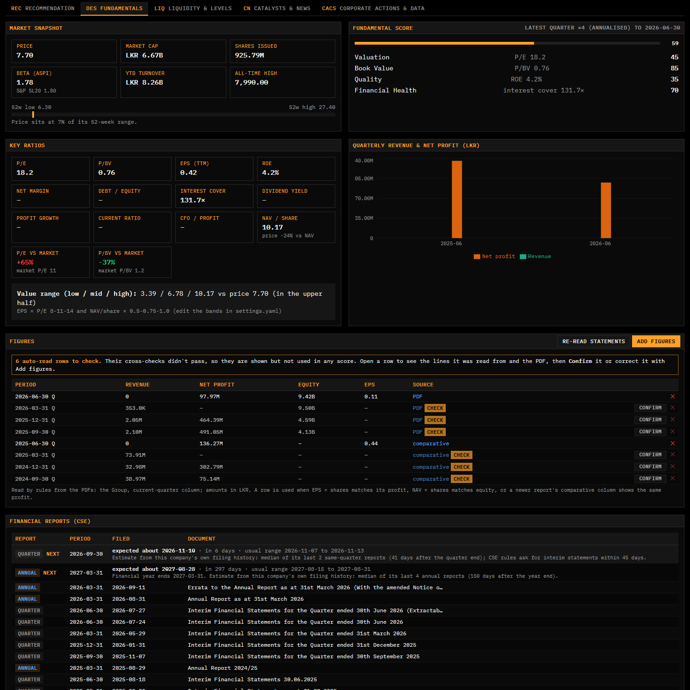

**Catalysts and news:** results, dividends, director dealings, announcements, and how this stock's price reacted to past events. Shown beside the engines, not part of their scores.

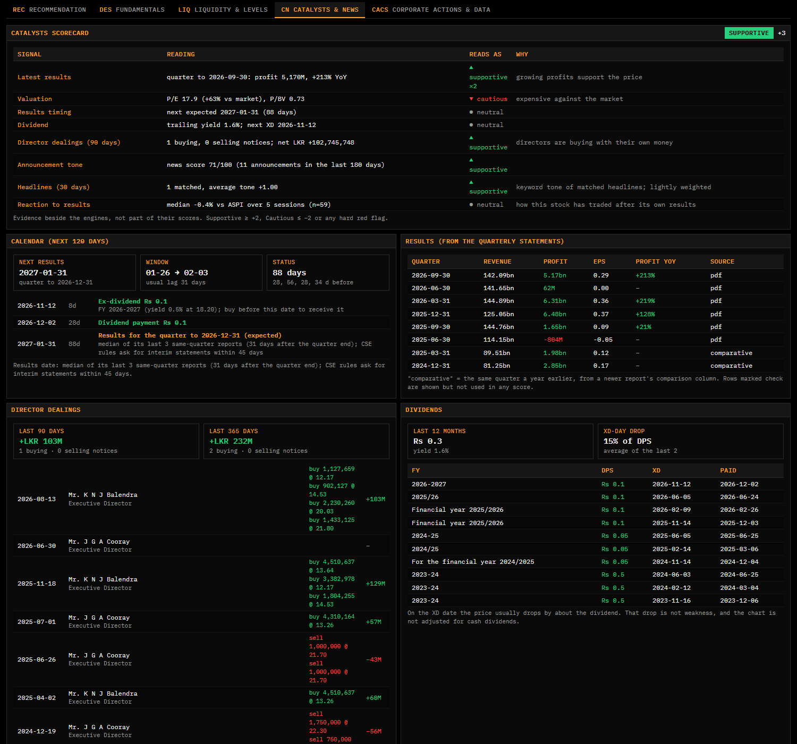

**Liquidity and levels**, and **the market** overview:

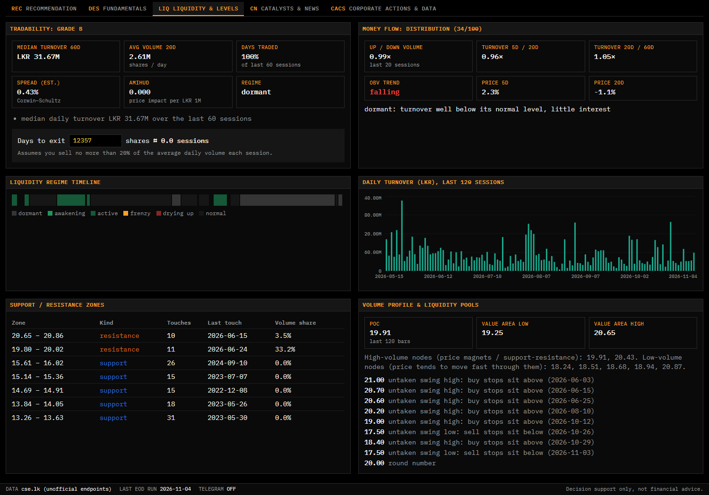

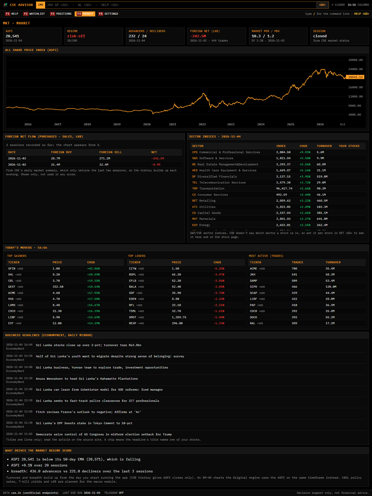

## What the tests found (and why this is a tool, not a signal service)

The repository includes the tests that check whether the signals work: a mirror-image test for every pattern detector, a 14-year event study of 53,292 pattern events across 43 stocks, and a study of the entry and exit plans (see *Testing whether the signals work* below). The honest results:

- Of 46 pattern types, **1** showed a stable edge over the stock's own trend (a rising wedge breaking upwards), 3 were weak and **42 had none**. Most apparent edges flip sign between years.
- Entering at a plan's buy zone and exiting at its stop or first target did no better than the same stop and target on random days. With about 2.6% round-trip trading cost, the average trade lost about 2.3%.
- Each pattern's explanation in the app therefore shows its measured track record ("Verdict: no edge") next to the pattern itself.

Use it to study charts, keep a consistent checklist and see the reasoning, not as a source of trades.

## Run it

Requirements: Python 3.11+ and Node 20+ (already installed on this PC).

```
start.bat
```

`start.bat` builds the web app the first time, starts the backend and opens <http://localhost:8000>. Keep the window open. The end-of-day analysis runs automatically at **15:30 Sri Lanka time** on weekdays. If the PC was off at that time, it runs as soon as you start the app.

Manual way:

```
cd backend
.venv\Scripts\python -m cse_advisor.main      # API + web app on :8000
cd ..\frontend && npm run dev                 # optional: hot-reload UI on :5173
```

**Start automatically at login:** Task Scheduler → Create Basic Task → *When I log on* → Start a program → `start.bat`.

## Telegram (free)

1. In Telegram, message **@BotFather** → `/newbot` → copy the token.
2. Copy `backend/.env.example` to `backend/.env` and set `TELEGRAM_TOKEN=...`.
3. Send your bot any message, then run `backend\.venv\Scripts\python -m cse_advisor.telegram_bot --whoami` and put the id it prints in `TELEGRAM_CHAT_ID=`.
4. Restart the app. Test with `python -m cse_advisor.telegram_bot --test`.

You'll get:
- an evening digest with the verdict, buy zone, stop, targets and top reasons for each stock
- alerts for signal changes, new high-priority patterns, material announcements and position stop/target hits
- intraday alerts when price enters a buy zone, crosses a trigger, or hits your stop (while the app is running)

Commands: `/watchlist`, `/report JKH` (sends a chart image too), `/levels JKH`, `/add JKH`, `/remove JKH`, `/positions`, `/run`, `/mute`, `/unmute`. The bot only obeys your chat id.

## Phone access

The app has no login, so by default only this PC can open it.
- **Same Wi-Fi:** add `HOST=0.0.0.0` to `backend/.env`, then open `http://<PC-IP>:8000` on the phone. Only do this on a trusted home network.
- **Anywhere:** install [Tailscale](https://tailscale.com) (free) on the PC and the phone and use the PC's Tailscale address. Set `APP_URL` in `.env` to that address so Telegram links work.

## Three engines, side by side

Every stock is analysed by three independent engines. Each has its own verdict, score, trade plan and explanation, and the app shows whether they **agree** (● all the same verdict), are **mixed** (◐) or **differ** (○, at least one bullish and one bearish).

| | **ORIG**: Original engine | **ANLY**: Analyst engine | **SMC**: Smart-money engine |
|---|---|---|---|
| Built from | the first version of the app | the KZOO / JKH / RIL example posts | the order-block and equilibrium bootcamp screenshots, plus common ICT / SMC practice for fair value gaps, liquidity sweeps, BOS / CHoCH and break & retest |
| Score | 5-factor composite: trend & patterns, liquidity, fundamentals, news, market | level score: starts at 50, then ± points for location, momentum, volume, extension, rights-issue phase, value range, reward:risk | SMC score: starts at 50, then ± points for weekly bias, daily BOS / CHoCH, discount vs premium, OTE band, tapping an unmitigated order block or fair value gap, block + gap overlap, weekly block underneath, fresh sell-/buy-side sweeps, supply overhead, reward:risk |
| Setups | pattern breakouts, pending breakouts, reversals at support, pullbacks to support / EMA20 | Entry 1 (Buy zone 1), Entry 2 (flip retest, support hold, break & retest), Zone 2, trendline break, base retest | OB entry (limit at the block's top, stop under it), FVG entry (limit at the gap's middle), break & retest of the broken structure level, weekly OB (refined to its top 2 ATR) |
| BUY needs | the 7-item checklist (score ≥ 70, triggered setup, liquidity ≥ C, no red flags, R:R ≥ 2, not above max-chase, trend not down) | the 9-item checklist (triggered level entry, R:R ≥ 2, not above max-chase, liquidity ≥ C, not over-extended, no extreme volatility, no rights XR gap / overhang, no going-concern / suspension flag, level score ≥ 55) | the 9-item checklist (weekly bias bullish, daily structure bullish, entry in discount, triggered OB / FVG / retest entry, R:R ≥ 2, not above max-chase, liquidity ≥ C, no going-concern / suspension flag, SMC score ≥ 55) |
| Targets | resistance zones, swing highs, 52-week high, pattern targets | sell zones (confluence), resistance, swing highs | buy-side liquidity above (untaken swing highs, equal highs), bearish blocks / gaps overhead, the dealing-range high |
| Rights issues | a red flag for 60 days (as originally built) | handled by the corporate-action phases (TERP, overhang) | not used (pure price action) |

All three engines use the same rights/split-adjusted prices. Alerts and the Telegram report carry an `[ORIG]` / `[ANLY]` / `[SMC]` tag.

### How the SMC engine reads a chart

- **Structure:** a swing high/low must beat the 3 bars on each side (`smc.swing_len`). A daily **close** beyond the latest swing is a break: BOS in the trend's direction, CHoCH against it. A wick beyond it that closes back inside is a **liquidity sweep** instead.
- **Order block:** the run of down candles just before the up move that broke structure, from the top of that run to its lowest wick (bearish block: the mirror image). A block wider than 2.5 ATR is refined to its last candle. A block is *fresh* until price returns, *tested* after each return, and *broken* on a close through its far side.
- **Premium / discount:** the dealing range is the impulse leg behind the latest break; 0.5 is equilibrium. Longs are taken in discount (below it) at a block or gap; OTE = the 0.62–0.79 retracement.
- **Fair value gap:** a 3-candle imbalance (candle 1's high below candle 3's low) after a displacement candle of at least 1 ATR.
- **Higher timeframe:** the same analysis on weekly bars sets the bias; a daily block inside a weekly block scores extra (the "refine on a lower timeframe" idea, with weekly → daily instead of daily → hourly).
- **Kill zones** are not used: they are intraday session windows and the app works on end-of-day CSE bars.
- Long only (no short selling on the CSE): bearish structure gives AVOID or WATCH, never a short.

## What you see (terminal-style UI)

Black background, amber labels, white data, IBM Plex Mono, Bloomberg-style command line.

- **Command line** (top). Type a ticker and a function, then Enter (= `<GO>`):
  - `JKH GP` chart & recommendation, `JKH CMP` engine comparison, `JKH SMC` smart-money view, `JKH DES` fundamentals, `JKH LIQ` liquidity & levels, `JKH CN` catalysts (news, results, events), `JKH CACS` corporate actions, `JKH PAT` pattern chooser
  - `WL` watchlist, `PORT` positions, `MKT` (or `WEI`) market, `SET` settings, `ADD JKH` add a stock, `HELP`
  - timeframes: `JKH 15M`, `JKH SMC 1H` (1M, 5M, 15M, 1H, 4H, 1D, 1W)
  - on a stock page a function or a timeframe on its own works too (`DES <GO>`, `4H <GO>`)
- **Keys:** `/` focuses the command line, `F1` help, `F2` watchlist, `F3` positions, `F4` market, `F8` settings, `P` opens the pattern chooser, `Esc` closes it; on the watchlist `↑ ↓ Enter`.
- **Watchlist (WL):** a monitor table with last price, change, 60-day sparkline, all three engines' verdicts and scores, the agreement, trend, liquidity and the next planned level. Click a column to sort.
- **Stock page:** security header, numbered toolbar (`1) Patterns & layers`, `2) Re-analyse`, `3) 1M 5M 15M 1H 4H 1D 1W`, `4) Candles | Line | Zig-zag`, `5) Raw prices`), the three engine panels, an "on chart" strip listing every drawing (✕ hides it), the chart, and tabs:
  - **REC:** Compare (side-by-side table), Original, Analyst and SMC views, each with summary, score breakdown, BUY checklist, reasons for/against, buy- and sell-price tables that say how every price was derived, sizing, scenarios and what to watch. The Analyst view adds the Entry 1 / Entry 2 / Zone 2 table, the level ladder and the momentum/volume/risk checks. The SMC view adds the smart-money context (weekly and daily structure, dealing range, equilibrium, OTE, open blocks and gaps, liquidity above and below) and the OB / FVG / retest entry table.
  - **DES** fundamentals (read automatically from the statement PDFs), **LIQ** liquidity & levels, **CN** catalysts: results, dividends, director dealings, calendar, headlines and announcements, with the scorecard; **CACS** corporate actions & CSV import.
  - The header also shows the **Catalysts** chip (Supportive / Neutral / Cautious) and **relative strength** (leader / in line / laggard: the stock's move minus the ASPI's over 20 / 60 / 120 sessions, and vs its sector if you set one in SET).
- **Pattern & layer chooser (`1) Patterns & layers`, `P` or `PAT`):** a large panel that slides in from the right while the chart keeps updating.
  - search box across everything
  - presets: Clean, Original, Analyst, SMC, All 3 (default), Everything, None, My default, Save as default
  - 1) Original patterns ranked by priority (Top 5 / High / All / None, filters for category, direction, status and age, a switch per pattern)
  - 2) Analyst levels, each with its own switch: Fibonacci leg, Buy zone 1 / 2, sell zones, each trendline, swing labels, anchored POC & value area, analyst patterns
  - 3) SMC drawings, each with its own switch: key order blocks (nearest below and above price, on by default), all blocks on the chart's timeframe and its higher timeframe, fair value gaps, premium / discount range, BOS / CHoCH lines, sweeps and equal highs / lows, and (1M / 5M / 15M) the CSE session windows
  - 4) Chart & indicators: which engine's trade plan to draw (Original = white solid `O:`, Analyst = pink dashed `A:`, SMC = lavender long dashes `S:`, or all), S/R, volume profile, liquidity pools, XR markers, EMAs, Bollinger, volume, RSI, MACD

  Choices are saved per stock.
- **Positions (PORT):** record what you bought; each evening all three engines review it as HOLD / TRIM / SELL with a stop. The page totals the book **after fees both ways** (`costs.brokerage_pct_per_side`): invested, market value, unrealised P/L if sold today, realised P/L, what is **at risk if every stop is hit** (in LKR and % of `risk.capital_lkr`), the largest position and the split by sector.

Chart colours were checked on black with a colour-blind palette validator; every drawing also has a text label and its own line style.

## Timeframes: 1M, 5M, 15M, 1H, 4H, 1D, 1W

The chart toolbar (`3)`) and the command line (`JKH 15M <GO>`, `JKH SMC 1H <GO>`, or just `4H <GO>` on an open stock) switch timeframes.

**Where the intraday bars come from**

cse.lk only gives **today's** individual trades. There is no intraday history, so the app combines two sources:

| Source | What | Depth (JKH, Nov 2026) |
|---|---|---|
| TradingView (unofficial, anonymous websocket, `CSELK:<SYMBOL>`) | ready-made 1m / 5m / 15m / 1H / 4H bars, ~5,000 per timeframe | 1m ~5 weeks (liquid stocks) to ~4 months (thin ones: a bar exists only for a minute that traded), 5m ~4 months, 15m ~13 months, 1H ~5 years, 4H ~7 years |
| cse.lk trades (`companyChartDataByStock` period 1) | every trade of today's session, recorded as 1-minute bars each evening and once a minute while an intraday chart is open | grows from the day you start the app |

- Per day the app uses TradingView's bars when it has the whole day. Like the daily chart's volume, they leave out **crossings** (negotiated block trades); the cse.lk trade list includes them (JKH 3 Nov 2026: 3.97M shares in the trades vs 1.89M share volume). cse.lk fills the days TradingView doesn't have, e.g. today during the session.
- Bars are anchored at the 09:30 open, as on TradingView: 1H bars start 09:30, 10:30 … 13:30, and 4H bars start 09:30 and 13:30.
- Intraday prices get the same rights / split adjustment as the daily chart. Day by day, the intraday closes match the adjusted daily closes within about 0.5%, the gap between the last trade and CSE's official close; KZOO's March 2026 XR is included.
- A stock's TradingView history is loaded when you add it (in the background, ~15 s), topped up every evening, and can be re-loaded with **Backfill history** on the stock page.
- TradingView is **not an official API**: it can stop working at any time. Turn it off with `intraday.tradingview: false` in settings.yaml; the app then builds intraday history only from the trades it records.

**The engines on intraday bars**

- On 1M / 5M / 15M / 1H / 4H the three engines run **on demand** on that timeframe's bars (the last 1,500 completed bars, about 1 s). The verdicts, plans, patterns and the pattern chooser on the stock page are then that timeframe's.
- The **watchlist, the nightly verdicts, alerts and Telegram stay on daily bars**. The intraday strip on the stock page shows the daily verdicts next to the intraday ones.
- Liquidity, fundamentals and news describe the stock, not the bar size, so they come from the latest daily analysis. On intraday charts the Original engine's market factor uses the ASPI on the same timeframe (from TradingView `CSELK:ASI` and cse.lk's intraday ASPI).
- **SMC higher timeframe:** 1M → 5M, 5M → 15M, 15M → 1H, 1H → 4H, 4H → daily (and daily → weekly as before). Texts and the checklist name the right timeframes ("1H bias is bullish").
- **CSE session windows**, the kill-zone adaptation: on 1M / 5M / 15M the drawer (3) SMC) can shade the opening hour (09:30–10:30) and the closing hour (13:30–14:30), when most CSE volume trades. The ICT London / New York kill zones don't apply to Colombo. The windows are shown only and **not scored**: there's no evidence they help.
- **Fees:** CSE costs (~1.1–1.3% a side) are bigger than most 5M / 15M targets, so the reward:risk-after-fees check usually fails on small timeframes and the engines mostly say WATCH or AVOID. That is the rules working, not a bug. Illiquid stocks also have gaps: a bar exists only when something traded.
- None of the engines has been walk-forward tested on intraday bars.


### Line chart, zig-zag, and the 1-minute chart

- **Candles | Line** (toolbar `4)`): the line is the close price, which shows the trend with less noise. The choice is remembered per stock. Patterns, plan lines, zones and markers are drawn the same in both styles.
- **Zig-zag**: a line through the swing highs and lows; price has to move 2 × ATR(14) against the running extreme to turn it, so it ignores small wiggles. On the line chart it joins swing *closes*, on candles it joins swing highs and lows. The last segment is the leg still in progress, so it can still change. It is also in the drawer under layers.
- **1M**: 5,000 TradingView minute bars (about 5 weeks for a liquid stock) plus every minute recorded from cse.lk trades. Thin stocks trade in few minutes, so the 1M line looks like steps and the engines see long flat runs: use it to see *when* trades happened, not for pattern signals. The intraday table's unique key now includes the source (it holds cse and TradingView 1m bars for the same minute); the app rebuilds the table once on start, keeping every row.
- **Next report dates** (DES tab, *Financial reports*): the next quarterly and the next annual report are listed above the PDF links with an expected date and the usual range, estimated from the company's own past filing delays (period end + the median days it took). CSE publishes no results calendar, so these are estimates; a company that changed its year end (DOCK) starts over and says the estimate is rough.

## Catalysts: news, results and events (CN)

The **CN** tab (`JKH CN <GO>`, or `CAT`) collects everything news-, results- and event-driven about a stock. A **scorecard** at the top rolls it up to **Supportive / Neutral / Cautious**. It is shown on the stock header and as its own row in the Compare view, **beside** the engines and never blended into their scores.

| Signal | Where it comes from | Reads as |
|---|---|---|
| Latest results | figures read from the newest quarterly statement (below) | profit up ≥ 10% YoY supportive (counts double), down ≥ 10% cautious |
| Valuation | P/E and P/BV vs the market P/E and P/BV from CSE's daily market summary | ≥ 25% cheaper supportive, ≥ 40% dearer cautious |
| Results timing | the company's own reporting lag over its last reports | shown; within 7 days it is an event-risk line |
| Dividend | cash dividends with DPS and XD dates | trailing yield ≥ 5% supportive |
| Director dealings | each director trade: buy / sell, quantity, price | net buying supportive, net selling ≥ LKR 1M cautious |
| Announcement tone | the classified CSE announcements (180 days, fading) | news score ≥ 62 / ≤ 38 |
| Headlines | EconomyNext and Daily Mirror business RSS, matched by company name or ticker in the title | keyword tone, lightly weighted, never a red flag |
| Reaction to results | how the price moved after this stock's own past results (since 2012), vs the ASPI | median ≥ +1% / ≤ −1% over 5 sessions, with at least 8 events |
| Corporate action / red flags | rights phases, going-concern / modified audit opinion / suspension | cautious; any hard red flag makes the whole card Cautious |

Supportive needs a total of +2, Cautious −2 (or a hard red flag). Below the scorecard:
- **Calendar:** ex-dividend, dividend payment and AGM dates from CSE, rights dates, and the **expected results date** (quarter end + this company's median reporting lag, using same-quarter history where there are at least two; CSE's rules ask for interim statements within 45 days).
- **Event risk** lines, which also appear in every engine's *what to watch next* list as text only: results within 7 days ("an entry before them carries event risk"), ex-dividend within 5 sessions ("the price drops by about the dividend; that is not weakness"), AGM, rights dates. `events.gate_buy` is not used: no BUY rule changed.
- **Results** table with profit YoY. A % change against a loss is left blank.
- **Director dealings** (90 / 365 days) and **dividends** (12-month DPS and yield, how much of the dividend came off on XD days).
- **How the price reacted** to each kind of event on this stock: the day's move and the 5-session move vs the ASPI, counted from the next session for anything published after the 14:30 close. With fewer than 8 events it says so instead of reading a habit into noise.
- **Headlines** naming the company (titles and links only), and the **announcement list**, filterable and searchable, each with its real subject and price reaction.

**Where the facts come from.** CSE's announcement list has titles only. Its site uses a detail endpoint, `getAnnouncementById` (found in cse.lk's own code), that returns typed records: dividend per share and XD / payment / AGM dates, each director trade with buy / sell, quantity and price, director appointments and AGM dates. Generic *Corporate Disclosure* notices fall back to `getGeneralAnnouncementById`, whose attachment file name carries the real subject ("Appointment of Deputy Chairman"). Each announcement is read once: dividends and dealings back 3 years, the rest 400 days. The first catch-up took about 9 minutes for six stocks.

**Changes in how announcements count:** classification now uses that text, with specific rules first and the generic "Corporate Disclosure" rule last. Director dealings finally have a direction. The Original engine's existing *director selling* red flag can now fire, but only for a net sale of at least LKR 1M within 30 days (`DIRECTOR_SELL_MIN_LKR`); before this, dealings were never read, so it never fired. Matched headlines join the Original engine's news factor at materiality 1 and half their tone.

## Financial statements, read automatically (DES)

Every evening the newest quarterly statements (`fundamentals.auto_reports`, default 6 quarters) are downloaded from CSE and read by rules, no LLM:
- **Column:** the **Group, current-quarter** column. Each block's period (quarter vs six or nine months) and entity (Group vs Company / Bank) come from the statement's own headers, so JKH's quarter-first, COMB's and SAMP's six-months-first and SAMP's Bank-before-Group layouts all work.
- **Fields:** revenue (total operating income for banks), operating profit, finance cost, **profit attributable to equity holders** (the period's profit when there are no minority interests), EPS, dividend per share, total assets, equity attributable, total liabilities and NAV per share.
- **Text handling:** amounts in Rs '000 are scaled to LKR. Commentary lines, note references and rows whose numbers print before the label are ignored.
- **Last year:** each report also gives the **same quarter a year earlier** from its comparative column (marked *comparative*), so YoY growth and trailing-12-month figures work from the first evening.
- **When a row is used:** EPS × shares matches its profit, NAV × shares matches equity, or a newer report's comparative column shows the same profit (within 2%). Anything else is kept as **check**: shown with the exact lines it was read from and a link to the PDF, **not used in any score** until you press *Confirm* or correct it. Manually entered rows are never overwritten. *Re-read statements* reads them again.
- **Coverage today:** all six stocks' latest statements read cleanly. COMB, SAMP, LOLC, RIL and JKH have every recent quarter validated. KZOO's quarters before its 2026 rights issue stay as *check*, because its share count tripled, and two scanned reports can't be read. The Original engine's fundamentals factor, P/E and P/BV vs the market and the Analyst engine's value range now work for every stock.

## More from cse.lk (shown only, not scored)

From the endpoints listed in the community [CSE API documentation](https://github.com/GH0STH4CKER/Colombo-Stock-Exchange-CSE-API-Documentation), each checked by hand:
- **Market status** (`marketStatus`): LIVE / CLOSED comes from CSE itself, so Poya days and other closures read as closed. If the call fails, the clock rule takes over.
- **Foreign flow and market valuation** (`dailyMarketSummery`): foreign purchases, sales and net, market PER / PBV / dividend yield on the Market page. CSE returns only the last two sessions, so the history builds each evening.
- **Sector indices** (`allSectors`): the 22 S&P/CSE sector indices, recorded each evening, on the Market page. CSE doesn't say which sector a stock is in; set it per stock in **SET**, and the stock page shows its sector's change. Most sector indices are licensed on TradingView, so their history starts when you start the app.
- **Movers** (`topGainers`, `topLooses`, `mostActiveTrades`) on the Market page, with **+ADD** for stocks not on the watchlist.
- **Market-wide notices** (`getNonComplianceAnnouncements`, `getFinancialAnnouncement`): a non-compliance or modified-audit-opinion notice for a watchlist company is stored as an announcement. A *modified audit opinion* (qualified, adverse or disclaimer) is a hard red flag, the same as a qualified opinion. Companies are matched by exact name, so "John Keells PLC" never matches JKH. A newly uploaded financial statement triggers an early report sync.

## Testing whether the signals work (pattern audit, event study, plan study)

Three tools, all rerunnable, answer three different questions. Reports are written to `backend/data/backtests/`.

| Question | Command | What it does |
|---|---|---|
| Is each detected pattern **real**? | the audit in `tests/` (`test_pattern_symmetry`, `test_pattern_status`) plus the live audit described below | planted patterns and their **mirror images** must be detected symmetrically; breakouts must fail only on a close back through the invalidation within 10 bars |
| Does a pattern **predict** anything? | `python -m cse_advisor.pattern_study` | causal rolling detection over 14 years of daily bars, forward returns after each pattern first confirms, against random days of the same stock on the same side of its 50-day average, significance clustered by calendar month |
| Is the **entry and exit plan** sound? | `python -m cse_advisor.backtest --calls` then `python -m cse_advisor.plan_study` | every BUY / WATCH call recorded with its plan, then entry and exit variants on the same calls, a random-timing control, and the cost drag |

`python -m cse_advisor.pattern_study --write-track-record` writes `config/pattern_track_record.json`; the app then adds a measured **track record** sentence to every daily pattern's explanation (median move 20 sessions later vs comparable days, hit rate, and a verdict: edge / weak / no edge / wrong way). Without the file nothing is added.

### What the audit found and fixed (4 Nov 2026)

- **Inverse head & shoulders could never be detected.** A sign error in the shoulder check rejected every valid one. Found by the mirror test; all five bullish / bearish pattern pairs are now symmetric.
- **'Failed' meant "price ever came back, even years later"** for triangles, and doubles / head & shoulders / flags had no failure check at all, so about 40% of old patterns carried a misleading status. A breakout now fails only on a close back through its invalidation level within 10 bars.
- **Flag geometry:** the channel was fitted including the pole's top bar, which tilted the upper line down so that at the breakout it sat below the flag's own lows (22% of flags had breakout and invalidation in the wrong order). Fitted on the consolidation only now; degenerate flags and head & shoulders whose neckline ran past the shoulders are rejected.
- **A breakout setup stayed an "entry" after price had run to the pattern's target** (RIL: T1 = today's close). Retired once price is at the target or more than 3 ATR past the breakout.
- **Plan text contradicted itself** ("limit order at 21.10 … don't pay above 19.50"). When no price in the zone reaches the required reward:risk, the text now says so, and says what actually drives it (the stop's distance against T1's) instead of "overhead resistance".
- **Bad prices in the history** (one zero-price bar) are skipped.
- **Live data didn't touch the stored signals.** The daily patterns and plans are computed after the close, so a +10% gap left a "bearish flag, target 77" on screen above the flag's own invalidation. A **live check** now compares the live price with every level of the stored analysis and says in words what the session has already overtaken (shown above the engine panels, in each engine panel and on the pattern). It never changes a verdict: a pattern fails or confirms only on a close.

### What the studies measured (14 years, 43 stocks, to 2 Nov 2026)

- **Patterns (53,292 events):** measured against random days of the same stock on the same side of its 50-day average, with month-clustered significance, almost nothing beats the stock's own trend. Of 46 pattern types: 1 *edge* (rising wedge breaking up, +6.2% over 20 sessions, hit rate 65% vs 50%, same sign in both halves of the history), 3 *weak* (descending triangle, hidden bearish divergence, squeeze breakout down), 42 *no edge*. Candlesticks as a group: about +0.2% (t = 0.4). Chart-pattern breakouts as a group: +1.35% (t = 2.0), better with volume confirmation. Most apparent edges flip sign between years (strong 2020-21 and 2023-25, negative 2015-18 and 2022).
- **Plans:** entering at the plan's buy zone and exiting at its stop / T1 performs the same as the same stop / target geometry on random days. Round-trip cost is about 2.6% of the entry, so the average trade loses about 2.3%; the plan's job is the risk limit and sizing, not a timing edge.
- Treat the pattern *priority* as a ranking of how clean the shape is, not as a probability.

## Level-based analysis (modelled on the KZOO / JKH / RIL examples)

- **Adjusted prices.** cse.lk history isn't adjusted for corporate actions. The app reads rights, bonus and split announcements and back-adjusts history before the ex-date, like TradingView. For KZOO's 2-for-1 rights at Rs 7: TERP = (20.70 + 2×7)/3 = 11.57, factor 0.5588. Before XR it warns about the gap. After XR it flags the supply overhang until about 3 weeks after the new shares list, and shows holders the pre-rights equivalent price.
- **Fibonacci on a log scale** of the dominant leg (0.236 … 0.786, golden pocket, extensions). This reproduces the analyst's KZOO, JKH and RIL levels. Single-bar freak wicks (such as KZOO's XR-day spike) are ignored as anchors.
- **Level ladder:** support/resistance bands with role flips ("former resistance, now support"), a volume profile anchored at the start of the leg (POC and value-area high/low), falling and rising trendlines, and 200-day-average rejections.
- **Confluence buy zones:** Buy zone 1 is the strongest cluster of levels below price; **Zone 2** is a deeper, separate entry used only if Zone 1 breaks, never for averaging down. Sell zones above price become the take-profit levels.
- **Entries:**
  - Entry 1: limit order in Buy zone 1
  - Entry 2: retest of a flipped level, hold of the current support, or a break and retest of resistance
  - Zone 2
  - base retest after a deep fall

  Each entry has its own stop, targets and after-fee reward:risk.
- **Checks:**
  - over-extension (RSI ≥ 80 or a recent 90+, ≥ 25% above EMA21)
  - RSI crossing 50 and oversold turns
  - heavy-volume streaks and rising selling volume
  - likely crossings, which are ignored
  - whipsaw volatility, which means AVOID until the direction is clear
  - drawdown from the peak
  - today's busiest traded price (from cse.lk intraday trades)
- **Value checks:** core EPS without one-off gains, NAV per share vs price, P/E and P/BV vs the market (set `valuation.market_pe` / `market_pbv` in settings.yaml), and a low/mid/high value range.
- **Accuracy (walk-forward, 40 most-traded stocks, Nov 2025 – Nov 2026, a falling market):**
  - 810 simulated level entries: 36% reached T1 before the stop, average −2.8% net after costs, about the same as the market drift
  - break-and-retest-of-resistance entries did best: 50% target-first, but only 50 trades
  - the full BUY rule allowed just 3 trades

  Use the levels to plan; don't treat them as signals on their own.
- **Settings:** turn pattern types on or off, run the analysis now, see job history.

## How the Original engine scores (short version)

| Factor | Weight | What it measures |
|---|---|---|
| Trend & patterns | 35% | 5-method trend vote (EMA alignment, swing structure, ADX, 50-bar regression, weekly trend) plus active patterns |
| Liquidity | 25% | Tradability grade A–E (turnover, days traded, spread estimate), money flow (up/down volume, OBV, turnover trend, trade size), liquidity regime |
| Fundamentals | 15% | P/E, P/BV, ROE, growth, leverage, interest cover (from the figures you enter) |
| News | 15% | CSE announcements, rule-classified, time-decayed; director selling, going-concern, suspensions etc. are hard red flags (rights issues are handled by the corporate-action logic) |
| Market | 10% | ASPI trend, breadth, market turnover |

Missing factors are excluded and their weight is redistributed. A **BUY** needs all of these:
- score ≥ 70
- a triggered setup (breakout, pullback to support, or reversal at support)
- liquidity grade C or better
- no red flags
- reward:risk ≥ 2 **after** ~1.3% costs per side
- price at or below the max-chase level

All prices are rounded to CSE ticks (0.10 below Rs 100, 0.25 above).

Tune everything in `backend/config/settings.yaml`: capital, risk per trade, broker fee, weights, thresholds. Pattern tiers and reliability priors are in `backend/config/pattern_catalog.yaml`.

## Data, and its limits

- Prices come from the JSON endpoints that cse.lk uses itself. They're **unofficial** and could change; all access lives in `backend/src/cse_advisor/cse_client.py`. Requests are kept tiny: a few per stock per day, plus one per minute while a chart is open during market hours.
- Intraday history comes from TradingView's chart feed (unofficial too; all access lives in `backend/src/cse_advisor/tv_client.py`, rate-limited and fail-soft). See *Timeframes* above.
- **Daily history goes back to 2012.** CSE gives one year of daily bars without opening prices. The app adds TradingView's daily bars for the years before that (`history.tradingview`), and replaces the estimated opens of CSE's year with TradingView's real ones. Measured on the six watchlist stocks over the overlapping year:
  - its opens were identical on every real end-of-day bar;
  - its closes were within 0.2–0.75% (median) of CSE's;
  - its volume excludes crossings, like CSE's trade-summary volume, while CSE's chart history includes them, so the history bars now use TradingView's volume and keep the difference as crossing volume;
  - **its older bars are already adjusted** for rights, bonus issues and splits (KZOO's pre-XR closes are about 44% lower than CSE's raw ones). So they are joined onto the app's own adjusted series at the first CSE day, scaled by the median ratio over 20 overlapping days (seam moves match TradingView's own day changes within 0.2%, RIL 1.2%).
  - The older bars have no raw (as-traded) prices, so the *Raw prices* view starts at CSE's year. The engines use the latest `history.analysis_bars` (2,000, about 8 years). RIL's TradingView history starts in 2017.
- CSV import (*Corporate actions & data* tab) still works for anything else.
- Financial statements are text PDFs and are read automatically (see *Financial statements* above); scanned ones need typing in.
- Reliability numbers are starting priors until a CSE backtest replaces them.

## Not built yet (roadmap)

Walk-forward test of the engines on intraday bars · Daily FT and Reddit (no working feed found) · CBSL rates / T-bill yields / LKR macro module (the CBSL site didn't respond to a plain request) · pattern scorecard per pattern type · recommendation journal page · optional Claude narrative (pay-per-use).

## Tests

```
cd backend && .venv\Scripts\python -m pytest -q
```

Synthetic price series with planted patterns (triangle, double bottom, head & shoulders, bull flag, engulfing) plus trade-plan rules: stop < entry < targets, valid ticks, the days-to-exit cap, and explanation numbers matching the plan.

Also covered:
- multi-year history: the stitch of TradingView's adjusted bars onto the app's series, the piecewise-constant intraday factor, real-open and crossing-volume handling (`tests/test_history.py`)
- statement parsing on excerpts of three real layouts (quarter-first, Bank-before-Group six-months-first, Group/Company), commentary and note references ignored, owners' share vs total profit, the cross-checks (`tests/test_report_parser.py`)
- catalysts: typed dividend / dealing / appointment records, attachment subjects, the director-selling threshold, the after-close reaction rule, results-due estimation, headline matching ('John Keells Hotels' is not JKH, 'Combined' is not COMB), the scorecard roll-up (`tests/test_catalysts.py`)
- portfolio totals after fees, risk to stops, concentration, relative strength (`tests/test_portfolio.py`)
- intraday bars: tick → 1-minute → 5M / 15M / 1H / 4H buckets (and the 1M chart itself, `tests/test_report_dates_and_1m.py`) anchored at 09:30, the TradingView-vs-cse.lk choice per day, the per-day price adjustment, session-aware time labels, all three engines on a synthetic 15M series (SMC higher timeframe = 1H), the market-status fallback, exact company-name matching and the modified-audit-opinion red flag (`tests/test_intraday.py`)
- the SMC detectors on a hand-built series with a known order block, fair value gap, BOS and sweep, and the SMC engine's independence from the other two (`tests/test_smc.py`, `tests/test_engines.py`)
- the two engines run independently: the Original checklist and setups are untouched by the analyst inputs, a rights issue is still an Original red flag, and the Analyst calls on KZOO 5 Mar (AVOID) and 29 Oct (WATCH) (`tests/test_engines.py`)
- the corporate-action maths (TERP, factor, pre-rights equivalent, parsers)
- log-scale Fibonacci, confluence zones, and the volatility and extension checks
- **replay tests** that run the app on the dates of the KZOO / JKH / RIL example posts, using only the data available on each date, and check that it finds the analyst's levels and calls (`tests/test_replay.py`)

Refresh the price fixtures with `python tests/fixtures/fetch_fixtures.py`.

## Disclaimer

CSE Advisor is educational software for personal analysis. It is **not** financial advice and the author is **not** a licensed financial adviser. Nothing it displays, sends or logs is an offer or solicitation to buy or sell any security. You are solely responsible for your decisions and for checking prices and company information with official sources and your broker. The software comes without warranty, and the author is not liable for any loss arising from its use.
