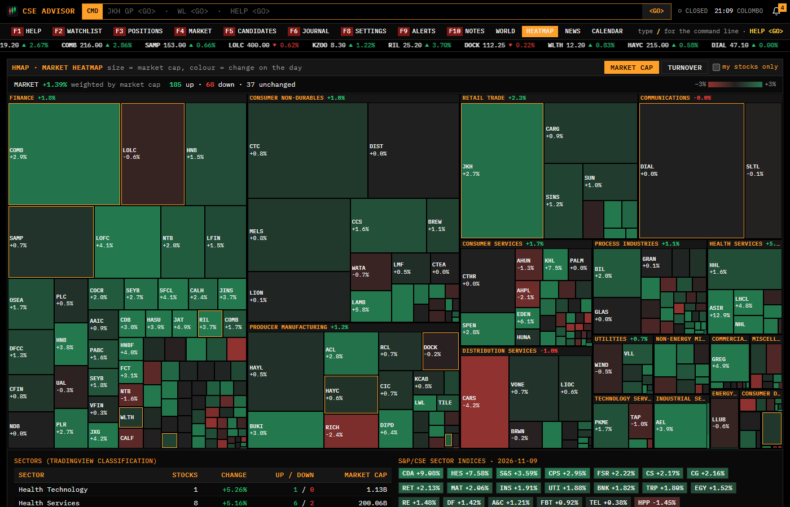
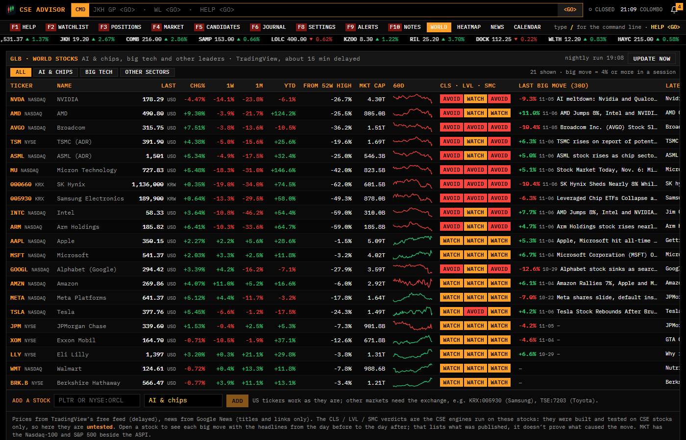
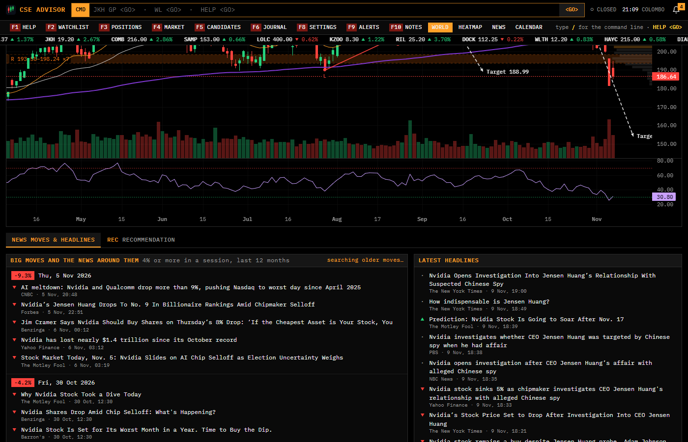
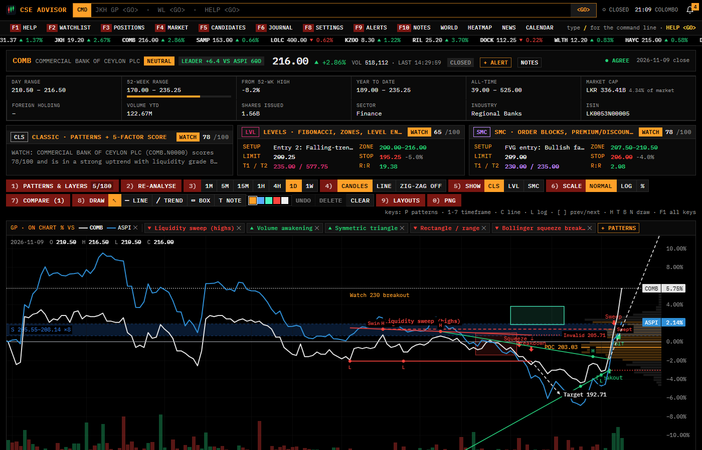

# CSE Advisor

A personal **analysis tool** for the Colombo Stock Exchange (CSE). You choose 10–20 stocks. After every close it scans each one for chart patterns, liquidity, levels and announcements, and shows what three rule-based engines found, **with the reasoning behind every number**. Patterns are drawn on a live chart, and an optional Telegram bot sends a daily digest.

It runs on your own computer (or your own server) with free data, and it never places an order. Sign-in is optional: off, it is a single-user app on this PC; on, anyone can create an account (email or Google) and each account has its own watchlist and positions.

> **Status: early preview, looking for feedback.** This is a personal project that I run on my own PC. It is not a hosted service, there is nothing to sign up for, and it is not yet a finished product. If you try it or just look at the screenshots, I would like to hear what is useful, what is confusing and what is missing: please open an issue.

> ## ⚠️ Not financial advice
> **CSE Advisor is a software tool that organises public market data and applies fixed technical-analysis rules to it. It is not financial, investment, legal or tax advice, and it is not a recommendation to buy, sell or hold any security.** The author is not a licensed financial adviser, and giving personalised investment advice may require a licence in your country. Words such as *BUY*, *WATCH*, *AVOID*, *entry*, *stop* and *target* are labels the rules produce from price history, not instructions.
>
> - **No edge is claimed.** The project's own 14-year tests found that most patterns do **not** predict price beyond the stock's existing trend, and that after CSE trading costs (about 2.6% per round trip) the average trade loses money.
> - You can lose all the money you invest. Past patterns do not predict future prices.
> - Data comes from unofficial endpoints (cse.lk, TradingView) that can be wrong, late or disappear. Check prices with your broker.
> - Make your own decisions or ask a licensed adviser. The software is provided "as is", without warranty, and the author accepts no liability for losses.
>
> Not affiliated with or endorsed by the Colombo Stock Exchange, TradingView or any broker.

## Architecture

```
 cse.lk JSON endpoints ─┐                                   ┌─ Classic (CLS)
 TradingView bars ──────┼─► SQLite ─► analysis/ ─► engines ─┼─ Levels  (LVL) ─► recommendations ─► FastAPI ─► React UI
 CSE announcements/PDFs ┘  (prices,   indicators,           └─ SMC            (verdict, plan,       │         (charts,
                            news,     patterns, levels,                        reasons)             │          watchlist)
                            figures)  liquidity, SMC                                                └─► Telegram digest / alerts
```

- **Data** (`cse_client.py`, `tv_client.py`, `ingest.py`, `intraday.py`): daily history back to 2012, intraday bars from 1 minute to 4 hours, announcements, and financial statements read from the PDFs by rules (no LLM). Prices are adjusted for rights issues and splits.
- **Analysis** (`analysis/`): indicators, chart and candlestick patterns, Fibonacci and confluence levels, liquidity, smart-money structure, corporate actions, catalysts.
- **Engines** (`strategy/`): three independent rule sets, each giving a verdict, score, trade plan (entry, stop, targets after fees) and a plain-language explanation. The UI shows whether they agree.
- **Jobs** (`jobs.py`): the end-of-day run at 15:30 Sri Lanka time on weekdays (analysis, forward-test journal, alerts, a nightly database backup), plus intraday checks while the app is open.
- **Stock selection** (`screener.py`, `analysis/selection.py`): after the close, ranks every liquid CSE stock on the one selection rule that held up in the tests (below). Shown only.
- **Forward-test journal** (`journal.py`): each evening's calls are written down once and scored later, as an honest check on the back-tests.
- **UI** (`frontend/`): React, TypeScript and lightweight-charts, with a terminal-style look and a command line (`JKH GP`, `WL`, `HELP`).

### The three engines

| | **CLS**: Classic | **LVL**: Levels | **SMC**: Smart money |
|---|---|---|---|
| Idea | chart and candlestick patterns plus a 5-factor score | Fibonacci, confluence buy / sell zones, trendlines, level entries | order blocks, fair value gaps, premium / discount, liquidity sweeps, BOS / CHoCH |
| Score | trend & patterns, liquidity, fundamentals, news, market | 50 ± points for location, momentum, volume, extension, reward:risk | 50 ± points for weekly bias, daily structure, discount, order block / gap, sweeps |
| BUY needs | a 7-item checklist | a 9-item checklist | a 9-item checklist |

A BUY in any engine requires, among other checks, a triggered setup, reward:risk of at least 2 **after** about 1.3% costs per side, liquidity grade C or better, and no hard red flags (going concern, suspension, qualified audit). All thresholds are in `backend/config/settings.yaml`. The engines are long-only, since the CSE has no short selling.

The engines were previously called *Original* and *Analyst*; their internal ids (`original`, `analyst`) are unchanged.

## Screenshots

Illustrations of the tool's output on 4 Nov 2026 with seven example stocks, not suggestions.

**Watchlist:** every stock with the three engines' verdicts side by side, trend, liquidity and the next key level.


**Stock page:** engine panels, the list of everything drawn on the chart, and the chart with patterns, zones and plan lines. Timeframes 1M to 1W; candles, line or zig-zag; a `Show CLS | LVL | SMC` toggle to see one engine's drawings at a time.


**Comparing the engines:** each engine's setup, prices and reasons for and against, in plain language. When they disagree, the page says so.


**Market heatmap:** every listed stock by sector, sized by market cap, coloured by the day's change. Sectors come from TradingView's public scanner.



**World stocks (GLB):** NVIDIA, SK Hynix, Micron, big tech and leaders from other sectors, with delayed quotes and the three engines run on them (untested outside the CSE).



**The news around each big move:** every session a world stock moved 4% or more, with the headlines published from the day before to the day after. It shows what was published, not proof of what caused the move.



**Chart tools:** compare against the ASPI or another stock as % change, and draw your own lines, boxes and notes (saved per stock).



## What the tests found

The repository includes the tests that check whether the signals work: a mirror-image test for every pattern detector, a 14-year event study of 53,292 pattern events across 43 stocks, and a study of the entry and exit plans.

- Of 46 pattern types, **1** showed a stable edge over the stock's own trend (a rising wedge breaking up), 3 were weak and **42 had none**.
- Entering at a plan's buy zone and exiting at its stop or first target did no better than the same stop and target on random days. With about 2.6% round-trip cost the average trade lost about 2.3%.
- Each pattern's explanation in the app shows this measured track record next to the pattern.

A later study (`factor_study.py`, 42 stocks, 14 years, after costs) looked for what does help:

- The only combination that held up in both halves of the history was a stock in an **uptrend** (close above its 50-day average, which is above its 200-day), **within 10% of its 52-week high**, and in the **top 40% by 120-day return**. It beat the average uptrending stock by roughly 1.5 to 3.5 points over 40 to 90 sessions. It was chosen after looking at the data, so it is *tested, not proven*; the journal keeps checking it on new data.
- Entry style (resting limit, next open, waiting for a bounce) made no difference, and the engines' BUY calls were no better than WATCH (Classic BUYs sat a median 21% below the 52-week high, still falling).
- Staying out of weak markets did not improve results, and candlestick patterns pooled showed no edge (they are hidden by default).

A macro study (`macro_study.py`, 2013–2026) checked world markets against the ASPI:

- **Brent oil:** no measurable link, not even for Lanka IOC.
- **USD/LKR and India's Nifty:** they move with the ASPI in the same week (r about −0.13 / +0.13). Neither predicts it.
- **Nasdaq and the S&P 500:** last month's move predicted the ASPI's next month only in 2020–26.
- **A 2%+ US fall overnight:** the next CSE session averaged −0.9% and fell 65% of the time (−0.3% in 2013–19, −1.1% in 2020–26). That's a short dip, small next to trading costs.

All of this is shown on MKT and recorded in the journal; no engine score uses it.

Use the tool to study charts and keep a consistent checklist, not as a source of trades. The studies are rerunnable (reports go to `backend/data/backtests/`):

```
python -m cse_advisor.pattern_study       # does a pattern predict anything?
python -m cse_advisor.backtest --calls    # record every call with its plan
python -m cse_advisor.plan_study          # is the entry / exit plan sound?
python -m cse_advisor.factor_study        # which stocks, entries and exits add return after costs?
python -m cse_advisor.macro_study         # do oil, US shares or the rupee move the ASPI?
```

## Run it

Requirements: Python 3.11+ and Node 20+.

```
start.bat
```

`start.bat` builds the web app the first time, starts the backend and opens <http://localhost:8000>. Keep the window open. Manual way:

```
cd backend
.venv\Scripts\python -m cse_advisor.main      # API + web app on :8000
cd ..\frontend && npm run dev                 # optional: hot-reload UI on :5173
```

With sign-in off the app listens on this PC only, and refuses to start on a network address (`HOST=0.0.0.0`) unless sign-in is on or you set `ALLOW_NO_AUTH=1`.

### Accounts (optional, needed before hosting it publicly)

Sign-in uses Firebase Authentication (free tier): email and password with verification, and Google. The server checks the Firebase ID token on every `/api` call. Shared market data (prices, analysis, screener, journal) is the same for everyone. Each account has its own watchlist, positions, position reviews (HOLD / TRIM / SELL), display settings and profile. Only the admin can change shared data (corporate actions, statements, sectors) or run the jobs.

1. In the [Firebase console](https://console.firebase.google.com): create a project and register a Web app. Under **Authentication > Sign-in method**, enable Email/Password and Google. Under **Settings**, add your domain to **Authorized domains**, keep **Email enumeration protection** on, and set the password policy (8+ characters, upper, lower, number, symbol).
2. In Google Cloud, open **APIs & Services > Credentials > the Web OAuth client** and add `https://<your domain>/__/auth/handler` as a redirect URI. Publish the consent screen ("In production"). The app proxies `/__/auth/*` to Firebase so sign-in works in Safari and home-screen apps.
3. In `backend/.env` set `FIREBASE_PROJECT_ID`, `FIREBASE_API_KEY`, `FIREBASE_APP_ID`, `FIREBASE_MESSAGING_SENDER_ID`, `APP_DOMAINS=<your domain>`, `ADMIN_EMAILS=<your email>` and `SUPPORT_EMAIL`. These web-config values are public; no service-account key is needed. Restart.
4. Sign up with the admin email and verify it. On **ACCT**, choose **Move it to my account** to take over the watchlist and positions made before sign-in. The Telegram digest then reports on your stocks.

Host it behind HTTPS (a reverse proxy, or a tunnel such as Cloudflare Tunnel) with `HOST=0.0.0.0`. The scheduler, SQLite and the data fetching all run in this one process, so it needs an always-on machine. Per-account limits are in `settings.yaml` (`accounts:`). To test sign-in locally without a real project, run the Firebase Auth emulator with a `demo-*` project id and set `FIREBASE_AUTH_EMULATOR_HOST=127.0.0.1:9099`. Unsigned emulator tokens are accepted only for `demo-*` projects.

### Telegram (optional)

1. Message **@BotFather** in Telegram, run `/newbot` and copy the token.
2. Copy `backend/.env.example` to `backend/.env` and set `TELEGRAM_TOKEN=...`.
3. Send your bot a message, run `python -m cse_advisor.telegram_bot --whoami` and put the printed id in `TELEGRAM_CHAT_ID=`.
4. Restart the app and test with `python -m cse_advisor.telegram_bot --test`.

You get an evening digest, alerts for signal changes and announcements, and commands such as `/watchlist` and `/report JKH`. The bot only obeys your chat id. With accounts on, it reports on one account's stocks: the Telegram owner, set on **ACCT** by the admin.

## More screens

- **Home (F2), tabs:** **Portfolio** (the stocks you hold, with quantity, average cost and the engines' HOLD / TRIM / SELL), your **named watchlists** (Watchlist 1, 2, 3...: add, rename or delete them with `+`, a stock can sit on several), and **All stocks**, every security the CSE lists (about 290) with price, change and turnover. Choose "+ Add to..." on any of them and it is fetched, analysed and opens as a full report. A stock stays tracked while it is on at least one list. The `ALL` command opens that tab.
- **SCR (F5), candidates:** the ranking above for all liquid stocks (median daily turnover of at least LKR 2M), with a `+ADD` button for stocks not on your watchlist. First run reads every ordinary share once (about 15 minutes), then only the liquid ones each evening.
- **JRN (F6), journal:** every BUY and WATCH call with its plan, scored after 5, 20, 40 and 60 sessions with fees, next to the back-test numbers. Needs a few months and roughly 100 scored calls per group before it means anything.
- **Positions, "Consider trimming":** information only. It lists bearish patterns that the tests found to fall more often than comparable days, and a close below the 50-day average. The HOLD / TRIM / SELL review is unchanged.
- **Market banner** on the watchlist: ASPI against its 100- and 200-day averages and market breadth. A description, not a signal; no engine uses it.
- **ALRT (F9), alerts and the inbox:** your own alerts on any stock you follow: price rises or falls to a level, up or down X% on the day, within X% of the 52-week high, volume at X times the 20-day average (all checked on each live quote while the market is open, so the app has to be running), and, checked each evening after the analysis, a new high-priority pattern, a new announcement (by importance), an engine changing its verdict, or the RSI crossing a level. Each alert fires at most once a day (price alerts can be set to fire once and switch off). Everything lands in the **inbox** (the bell in the header shows the unread count): your alerts plus the engines' own (stop or target hit, entry trigger, buy zone, the evening's signal changes). The Telegram owner also gets them on Telegram; browser pop-ups are optional. **+ Alert** in a stock's header has one-click +/-3% and +/-5% price alerts. Inbox entries are kept 90 days.
- **NOTE (F10), notes:** free-text notes with tags on a stock (the **NOTE** tab on its page, and a count in its header), on a position (**Notes** button in PORT), or on nothing in particular. Closing a position asks what went right or wrong and saves it as a note tagged `review`. The NOTE page searches all of them.
- **Chart tools** (the toolbar above every chart, CSE and world stocks):
  - **6) Scale:** normal, logarithmic or % change from the first bar in view.
  - **7) Compare:** up to three lines (the ASPI, S&P 500, Nasdaq-100, any of your stocks or a world stock) as % change beside the stock on the daily chart; the stock itself becomes a white line, and each comparison has its own colour, dash and label (colours checked for colour-blind readers).
  - **8) Draw:** horizontal lines, trendlines, boxes and text notes. A point snaps to the bar's open, high, low or close when close to it; drag a drawing (or an end point) to move it, Delete removes it, Ctrl+Z undoes. Drawings are saved per stock for your account and show on every timeframe.
  - **9) Layouts:** save the current set-up (layers, engines, style, scale, timeframe, comparison) under a name and apply it to any stock. **0) PNG** saves the chart as an image.
  - **Keys:** 1-7 timeframe, C candles/line, L log scale, [ and ] previous/next stock in your list, H/T/B/N drawing tools, Esc stops drawing (F1 lists them all).
- **GLB, world stocks:** NVIDIA, AMD, Broadcom, TSMC, ASML, Micron, SK Hynix, Samsung, Intel and Arm (AI & chips), the big tech names, and leaders from other sectors (JPMorgan, Exxon, Eli Lilly, Walmart, Berkshire); add any other with a ticker (`PLTR`, or `KRX:005930` for other markets) or remove one. Delayed quotes (TradingView's free feed, 15-20 min) with week, month and year performance; each stock opens the same chart, patterns and engine panels as a CSE stock, plus a **NEWS** tab listing every session it moved 4% or more (`global_stocks.move_pct`) with the headlines from the day before to the day after (Google News, found by company name and its CEO; market news and stories matching the move's direction first). Big moves are also marked on the chart. Updated each night after the US close (07:00 Colombo, caught up hourly). The engines were built and tested on CSE stocks only: on these they are **untested**, their targets are net of CSE fees, and the position size is left out. The headlines show what was published around a move, not proof of what caused it.
- **HMAP, heatmap:** every listed stock as a tile grouped by sector, sized by market cap (or today's turnover) and coloured by its change on the day; amber outline = on your lists; click a tile to open the stock (or its quote card). Sectors and industries come from TradingView's public scanner (refreshed weekly, display only: no engine uses them; the S&P/CSE sector index you can set in SET is still what the relative-strength line uses).
- **NEWS, feed:** the CSE's announcements and the news headlines in one list, newest first, for your stocks or all tracked ones, filtered by type, tone, period and search. **CAL, calendar:** a month grid and list of results due (estimated), ex-dividend dates, payments, AGMs and corporate actions for your stocks, plus dates you add yourself.
- **Quote card:** type any listed ticker (`ABAN <GO>`) or click it in All stocks or the heatmap and you get today's price, ranges, market cap, foreign holding and sector, with an Add button; nothing is fetched or stored until you add it. Every stock page also has a key-statistics strip under its header.
- **Ticker tape** under the menu (desktop; switch off in SET) and click-to-sort columns on CANDIDATES; All stocks has a Sector column and filter.
- **Keeping the data current:**
  - The evening run is at 15:30 on weekdays. If the PC was asleep or off, the app notices within 15 minutes of waking (and at start-up) that the last session has no run, and does it then. A session the CSE did not hold (a holiday) is recorded as done.
  - The footer shows the as-of date of prices, analysis, news and world markets; an amber banner appears when data is behind. **Settings > Data health** lists each source and every step of the last run, so a broken data source is no longer hidden behind an overall OK.
- **Backups and moving the data:**
  - Each evening the database is copied to the `backups` folder (newest 14 kept). Once a week the newest copy is zipped into `backup.offsite_dir` (default: a `CSE-Advisor-backups` folder in your OneDrive, if you have one; `off` to turn it off).
  - Keep the database **out of OneDrive**: OneDrive syncing a live SQLite file can corrupt it. With the app closed, run `python -m cse_advisor.tools.move_data` (copies and checks every table, then sets `CSE_DATA_DIR` in `backend/.env`, and keeps the old folder renamed rather than deleting it).
  - To go back to a backup, close the app and run `python -m cse_advisor.tools.restore` to list them, then `python -m cse_advisor.tools.restore <file>`. The database it replaces is kept beside it.
  - `install_autostart.ps1` starts the app when you log in to Windows.

## Data and limits

- Prices come from the JSON endpoints cse.lk itself uses, and intraday history from TradingView's chart feed. Both are **unofficial** and could change; all access lives in `cse_client.py` and `tv_client.py`. Requests are few and rate-limited.
- Daily history goes back to 2012 (TradingView bars are stitched onto the rights-adjusted series). Intraday depth varies by timeframe and by how often a stock trades.
- Financial statements are text PDFs read by rules and cross-checked; scanned ones need typing in.
- **News sources:**
  - Daily FT, Daily Mirror, LBO, The Island, Ada Derana, CBSL press releases, and Google News searches: one per tracked company, plus world themes.
  - Sites that refuse automated readers (EconomyNext's feed, Daily News) are left out, not worked around. The MKT page shows each source's state.
  - Only titles and links are kept.
- **Claude reads the headlines when you switch it on:**
  - Set `llm.enabled: true` and `ANTHROPIC_API_KEY`; it costs about a cent a night with Claude Haiku. Otherwise keyword rules are used.
  - Either way, only headlines *about* a company count, each story counts once, it's lightly weighted, and it never raises a red flag.
- CSE costs (about 1.1–1.3% a side) exceed most 5M / 15M targets, so the engines mostly say WATCH or AVOID on small timeframes.
- The intraday engines have not been walk-forward tested.

## Tests

```
cd backend && .venv\Scripts\python -m pytest -q
cd frontend && npm test                       # sign-in rules (Node 22.18+)
```

Covers the pattern detectors (planted and mirrored patterns), trade-plan rules, the three engines and their independence, intraday bar building, statement parsing, catalysts, corporate-action maths, portfolio totals, replay tests against known example setups, sign-in (token checks, each account seeing only its own data, the migration of a pre-accounts database), the evening-run watchdog, data health, backups and restore, the alert rules and notes, and the market-overview routes and heatmap geometry, and the world stocks (time zones, big moves, the headlines around them, the routes).

## Disclaimer

CSE Advisor is educational software for personal analysis. It is **not** financial advice and the author is **not** a licensed financial adviser. Nothing it displays, sends or logs is an offer or solicitation to buy or sell any security. You are solely responsible for your decisions and for checking prices and company information with official sources and your broker. The software comes without warranty, and the author is not liable for any loss arising from its use.
